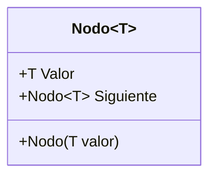
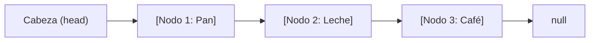
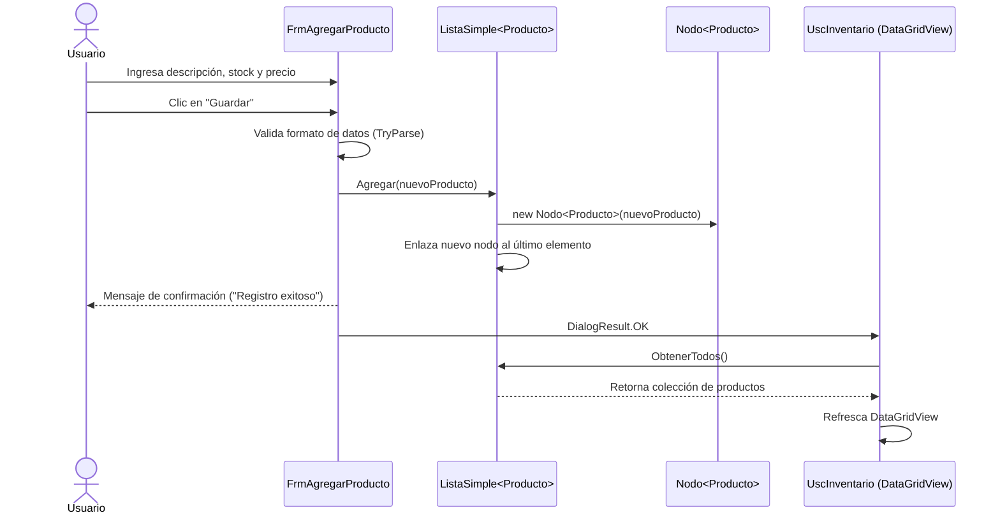
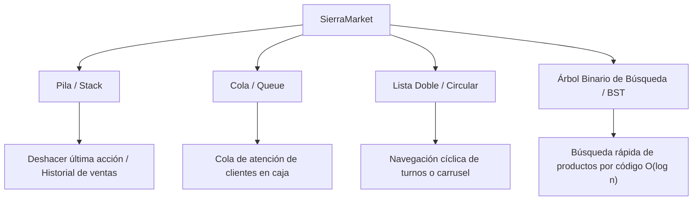

# 🛒 SierraMarket — Sistema de Punto de Venta e Inventario

> **Proyecto Académico — Curso de Estructuras de Datos**  
> **Plataforma:** .NET 10 (C#) · Windows Forms  
> **Estado:** En desarrollo activo 🚀

---

## 📋 Índice
1. [Descripción General](#-descripción-general)
2. [Objetivo Académico del Proyecto](#-objetivo-académico-del-proyecto)
3. [Estructuras de Datos Implementadas](#-estructuras-de-datos-implementadas)
   - [El Nodo Genérico (`Nodo<T>`)](#1-el-nodo-genérico-nodot)
   - [La Lista Simplemente Enlazada (`ListaSimple<T>`)](#2-la-lista-simplemente-enlazada-listasimplet)
   - [Análisis de Complejidad Algorítmica (Big-O)](#3-análisis-de-complejidad-algorítmica-big-o)
4. [Arquitectura del Proyecto](#-arquitectura-del-proyecto)
5. [Módulos y Funcionalidades Implementadas](#-módulos-y-funcionalidades-implementadas)
   - [1. Gestión de Inventario](#1-gestión-de-inventario)
   - [2. Control y Registro de Turnos](#2-control-y-registro-de-turnos)
   - [3. Módulo de Ventas (En Construcción)](#3-módulo-de-ventas-en-construcción)
   - [4. Sistema de Diseño y UI Personalizada](#4-sistema-de-diseño-y-ui-personalizada)
6. [Flujo de Datos en la Aplicación](#-flujo-de-datos-en-la-aplicación)
7. [🎓 Guía de Explicación y Defensa para el Grupo](#-guía-de-explicación-y-defensa-para-el-grupo)
   - [Preguntas típicas del docente y cómo responderlas](#preguntas-típicas-del-docente-y-cómo-responderlas)
8. [Próximas Estructuras y Mejoras en el Roadmap](#-próximas-estructuras-y-mejoras-en-el-roadmap)
9. [Requisitos y Cómo Ejecutar el Proyecto](#-requisitos-y-cómo-ejecutar-el-proyecto)

---

## 📌 Descripción General

**SierraMarket** es una aplicación de escritorio diseñada para simular la operación comercial de un minimarket o tienda de retail. Integra funciones esenciales como:
- Registro y consulta de inventario de productos.
- Gestión de turnos para el personal de caja.
- Interfaz modular para el proceso de venta.

A diferencia de una aplicación comercial estándar que delegaría el almacenamiento a bases de datos o colecciones predeterminadas de .NET, **SierraMarket está construido con fines pedagógicos para demostrar la implementación práctica de estructuras de datos lineales creadas desde cero**.

---

## 🎯 Objetivo Académico del Proyecto

1. **Aprender gestión de memoria mediante punteros/referencias:** Comprender cómo se encadenan elementos en la memoria dinámica mediante nodos y enlaces siguientes.
2. **Implementación de colecciones genéricas:** Diseñar estructuras abstractas y reutilizables (`<T>`) que puedan alojar cualquier modelo (`Producto`, `Turno`, etc.).
3. **Desacoplamiento entre lógica de estructuras y la interfaz visual:** Conectar estructuras de datos dinámicas con controles gráficos como `DataGridView` y `ListBox` sin violar el encapsulamiento.
4. **Construcción de software profesional:** Aplicar buenas prácticas de diseño de interfaces, componentes reutilizables y arquitectura por capas en C#.

---

## 🧠 Estructuras de Datos Implementadas

### 1. El Nodo Genérico (`Nodo<T>`)
Ubicación: `SierraMarket/Estructuras/Listas/Nodo.cs`

El nodo es la unidad fundamental de almacenamiento de las estructuras enlazadas. Contiene dos elementos esenciales:
- **`Valor` (`T`):** El dato o entidad que se almacena (por ejemplo, un objeto `Producto` o `Turno`).
- **`Siguiente` (`Nodo<T>`):** Una referencia (puntero) que apunta al siguiente nodo en la memoria. Si es el último elemento, su valor es `null`.



---

### 2. La Lista Simplemente Enlazada (`ListaSimple<T>`)
Ubicación: `SierraMarket/Estructuras/Listas/ListaSimple.cs`

Una colección lineal dinámica donde cada nodo apunta exclusivamente al siguiente. A diferencia de un arreglo convencional, **no requiere un tamaño fijo predeterminado** y crece dinámicamente según la necesidad.



#### Atributos principales:
- `cabeza` (`Nodo<T>`): Puntero al primer nodo de la lista. Si la lista está vacía, es `null`.
- `count` (`int`): Contador que registra en tiempo constante la cantidad total de elementos almacenados (`Count`).

#### Operaciones implementadas:
- **`Agregar(T valor)`:**
  1. Instancia un nuevo `Nodo<T>`.
  2. Si `cabeza == null`, el nuevo nodo se convierte en la cabeza.
  3. Si ya existen nodos, recorre la lista mediante un puntero temporal `actual` hasta llegar al nodo cuyo `Siguiente == null` y enlaza el nuevo nodo al final.
  4. Incrementa el contador `count`.
- **`ObtenerTodos()`:**
  - Recorre secuencialmente todos los nodos desde `cabeza` hasta `null`.
  - Extrae el `Valor` de cada nodo y lo compila en una lista iterable para que los controles de Windows Forms (`DataGridView`, `ListBox`) puedan renderizarlo de forma segura.

---

### 3. Análisis de Complejidad Algorítmica (Big-O)

| Operación | Método | Complejidad Temporal | Justificación |
|---|---|:---:|---|
| **Contar elementos** | `Count` | $\mathcal{O}(1)$ | Se mantiene un contador interno que se incrementa en cada inserción. |
| **Inserción (al final)** | `Agregar(T valor)` | $\mathcal{O}(n)$ | Debe recorrer los $n$ nodos existentes desde `cabeza` para encontrar el último enlace `null`. *(Oportunidad de optimización: agregar un puntero `cola` para lograr $\mathcal{O}(1)$).* |
| **Recorrido completo** | `ObtenerTodos()` | $\mathcal{O}(n)$ | Requiere visitar obligatoriamente cada uno de los $n$ nodos de la lista. |
| **Búsqueda secuencial** | *(En desarrollo)* | $\mathcal{O}(n)$ | En el peor de los casos se examinan todos los nodos hasta encontrar la coincidencia. |

---

## 🏗️ Arquitectura del Proyecto

El código está estructurado en capas limpias y desacopladas para mantener la separación de responsabilidades:

```
SierraMarket/
├── Estructuras/                  # 🧬 Implementación de estructuras de datos
│   └── Listas/
│       ├── Nodo.cs               # Clase base de nodo genérico
│       └── ListaSimple.cs        # Lista simplemente enlazada genérica
│
├── Modelos/                      # 📦 Entidades del dominio del negocio
│   ├── Producto.cs               # Entidad Producto (Id, Descripcion, Stock, Precio)
│   └── Turno.cs                  # Entidad Turno (Id, Nombre, HoraInicio, HoraFin)
│
├── UI/                           # 🖥️ Capa de presentación (Windows Forms)
│   ├── FrmPrincipal.cs           # Ventana maestra con navegación modular
│   ├── FrmTurnos.cs              # Ventana modal de gestión de turnos
│   ├── UscInventario.cs          # Control de usuario: Vista de inventario
│   ├── UscVenta.cs               # Control de usuario: Vista de catálogo y venta
│   │
│   ├── Formularios/
│   │   └── Inventario/
│   │       └── FrmAgregarProducto.cs # Formulario modal para registrar producto
│   │
│   ├── Componentes/              # 🧩 Controles UI reutilizables estilo shadcn
│   │   ├── Boton.cs              # Botones estilizados (Primario, Secundario, Transparente)
│   │   ├── CampoTexto.cs         # Input de texto con contenedor y bordes planos
│   │   ├── CampoEtiquetado.cs    # Par Etiqueta + Input agrupados
│   │   └── Texto.cs              # Jerarquía tipográfica (Titulo, Subtitulo, Etiqueta, Pequeno)
│   │
│   └── Tema/                     # 🎨 Tokens visuales y tipografía
│       ├── Colores.cs            # Paleta minimalista (Fondo, Borde, Primario, Secundario)
│       └── Fuentes.cs            # Cargador dinámico de la fuente Geist Mono (.ttf)
│
├── Recursos/
│   └── Fuentes/                  # Archivos TrueType de Geist Mono (Thin a Black)
├── Program.cs                    # Punto de entrada de la aplicación
└── SierraMarket.csproj           # Archivo de configuración del proyecto .NET 10
```

---

## ⚡ Módulos y Funcionalidades Implementadas

### 1. Gestión de Inventario
- **Vista interactiva (`UscInventario`):** 
  - Muestra los productos en un `DataGridView` personalizado sin bordes pesados.
  - Columnas: *Código*, *Producto*, *Stock*, *Precio* y botón de acción rápida.
  - Buscador visual integrado para filtrado de existencias.
- **Formulario de alta (`FrmAgregarProducto`):**
  - Registro de descripción, stock y precio unitario.
  - **Validaciones robustas:**
    - Verifica que la descripción no esté vacía.
    - Comprueba que el stock sea un número entero válido (`int.TryParse`).
    - Valida el precio admitiendo separadores decimales (`decimal.TryParse`).
  - Asignación automática incremental del identificador único: `id = _listaProductos.Count + 1`.
  - Inserción directa en la `ListaSimple<Producto>`.

### 2. Control y Registro de Turnos
- **Ventana de turnos (`FrmTurnos`):**
  - Permite a los cajeros registrar aperturas y turnos de trabajo.
  - Campos: Nombre del turno, Hora de Inicio (`DateTimePicker`) y Hora de Fin.
  - Almacena los registros en su propia instancia de `ListaSimple<Turno>`.
  - Visualización en un `ListBox` con sobreescritura de formato (`ToString()` formateado: `Id - Nombre - Horario: HH:mm - HH:mm`).

### 3. Módulo de Ventas (En Construcción)
- **Vista principal de caja (`UscVenta`):**
  - Diseño en dos columnas proporcionales:
    - **65% (Izquierda):** Catálogo de productos disponibles con barra de búsqueda rápida.
    - **35% (Derecha):** Panel para ticket de venta actual, totales y cálculo de cambio.
  - Conexión compartida a la misma instancia de `ListaSimple<Producto>` que utiliza el inventario (garantizando consistencia de datos).

### 4. Sistema de Diseño y UI Personalizada
- **Estilo Moderno / Minimalista:** Inspirado en sistemas de diseño web modernos (Shadcn UI), usando paletas sobrias en blanco y gris suave (`#FAFAFA`, `#E4E4E7`).
- **Tipografía Geist Mono:** Se cargan dinámicamente 8 pesos de la fuente desde `Recursos/Fuentes/` usando `PrivateFontCollection` en GDI+.
- **Navegación tipo Single Page Application (SPA):** El formulario maestro `FrmPrincipal` intercambia los `UserControl` dentro de su panel central (`pnlPrincipal`) sin necesidad de parpadear o abrir múltiples ventanas flotantes desordenadas.

---

## 🔄 Flujo de Datos en la Aplicación

El siguiente diagrama ilustra cómo viaja la información desde la entrada del usuario hasta la estructura en memoria:



---

## 🎓 Guía de Explicación y Defensa para el Grupo

> 💡 **Tip para la exposición:** Utilicen esta sección para repartirse los temas y responder con seguridad las preguntas del profesor.

### División sugerida para el equipo:
1. **Compañero 1 — Introducción y Arquitectura:** Explicar qué problema resuelve SierraMarket, cómo está organizado el proyecto por carpetas y cómo funciona la navegación con `UserControls`.
2. **Compañero 2 — Estructuras de Datos (`Nodo<T>` y `ListaSimple<T>`):** Explicar el código de los nodos, el encadenamiento mediante referencias a memoria y cómo se evita usar colecciones nativas de almacenamiento.
3. **Compañero 3 — Módulos Funcionales (Inventario, Turnos y Ventas):** Demostrar el funcionamiento de agregar productos, validación de formularios y refresco del DataGridView.
4. **Compañero 4 — Análisis Algorítmico y Roadmap:** Explicar el costo Big-O de las operaciones actuales y las próximas estructuras que se van a implementar (Pilas, Colas, Árboles).

---

### Preguntas típicas del docente y cómo responderlas

#### ❓ 1. "¿Por qué crearon su propia `ListaSimple` si C# ya tiene `List<T>`?"
> **Respuesta:**  
> "En C#, `List<T>` es internamente un arreglo dinámico (*dynamic array*), no una lista enlazada. Nosotros implementamos `ListaSimple<T>` y `Nodo<T>` desde cero para demostrar el manejo explícito de memoria mediante punteros y referencias enlazadas, cumpliendo con el objetivo académico de la materia. Solo usamos `List<T>` de forma temporal en el método `ObtenerTodos()` como un puente para transferir los datos al `DataGridView` de Windows Forms."

#### ❓ 2. "¿Qué ocurre internamente en la memoria cuando se ejecuta `Agregar()`?"
> **Respuesta:**  
> "Se crea una nueva instancia de `Nodo<T>` en la memoria Heap. Si la lista está vacía (`cabeza == null`), la variable `cabeza` apunta directamente a este nodo. Si ya contiene elementos, se crea un puntero auxiliar que recorre nodo por nodo mediante `.Siguiente` hasta encontrar el último (aquel cuyo `.Siguiente` es `null`). Al llegar a él, se enlaza su puntero `.Siguiente` al nuevo nodo creado."

#### ❓ 3. "¿Cuál es la complejidad temporal de agregar un elemento y cómo podría mejorarse?"
> **Respuesta:**  
> "Actualmente es $\mathcal{O}(n)$, porque la lista solo guarda una referencia a la `cabeza` y necesita recorrer los $n$ nodos para llegar al final.  
> Podríamos optimizarlo a $\mathcal{O}(1)$ agregando una referencia adicional llamada `cola` o `tail`. De ese modo, la inserción al final se hace directamente en un solo paso: `cola.Siguiente = nuevo; cola = nuevo;`."

#### ❓ 4. "¿Por qué el `Nodo<T>` y la `ListaSimple<T>` usan tipos genéricos (`<T>`)?"
> **Respuesta:**  
> "Para respetar el principio de reutilización de código y tipado fuerte (*Type Safety*). Al usar `<T>`, la misma estructura de datos puede almacenar objetos `Producto` en el inventario o instancias de `Turno` en el módulo de turnos, evitando el *boxing/unboxing* y garantizando que el compilador detecte errores de tipo."

---

## 🚀 Próximas Estructuras y Mejoras en el Roadmap

Para las siguientes entregas del curso de estructura de datos, el proyecto integrará:



1. **Pila (Stack - LIFO):**
   - Implementar el historial de ventas o el comando *Deshacer (Undo)* al agregar artículos erróneos a la factura.
2. **Cola (Queue - FIFO):**
   - Sistema de turnos de clientes en espera de caja o cola de impresión de boletas.
3. **Lista Doblemente Enlazada / Circular:**
   - Para navegar productos hacia adelante y hacia atrás, o gestionar turnos de forma rotatoria.
4. **Árbol Binario de Búsqueda (BST) o Tablas Hash:**
   - Optimizar la búsqueda de productos en el inventario de $\mathcal{O}(n)$ a $\mathcal{O}(\log n)$ o $\mathcal{O}(1)$.
5. **Algoritmos de Ordenamiento:**
   - Ordenar inventario por precio, stock o descripción utilizando *Quicksort* o *Mergesort* implementados a mano.

---

## 💻 Requisitos y Cómo Ejecutar el Proyecto

### Requisitos previos:
- SDK de **.NET 10.0** instalado.
- Sistema Operativo: **Windows 10 / 11** (requerido por Windows Forms).
- IDE recomendado: **Visual Studio 2022 / 2026** (con la carga de trabajo de *.NET Desktop Development*) o **Visual Studio Code** con la extensión de C# Dev Kit.

### Pasos para ejecutar:
1. Clonar o descargar el repositorio en tu equipo.
2. Abrir una terminal en la carpeta raíz del proyecto:
   ```powershell
   cd SierraMarket
   ```
3. Restaurar dependencias y compilar:
   ```powershell
   dotnet build
   ```
4. Iniciar la aplicación:
   ```powershell
   dotnet run --project SierraMarket/SierraMarket.csproj
   ```

---

<p align="center">
  <b>SierraMarket</b> — Desarrollado para el curso de Estructura de Datos (2026-2) 📚
</p>